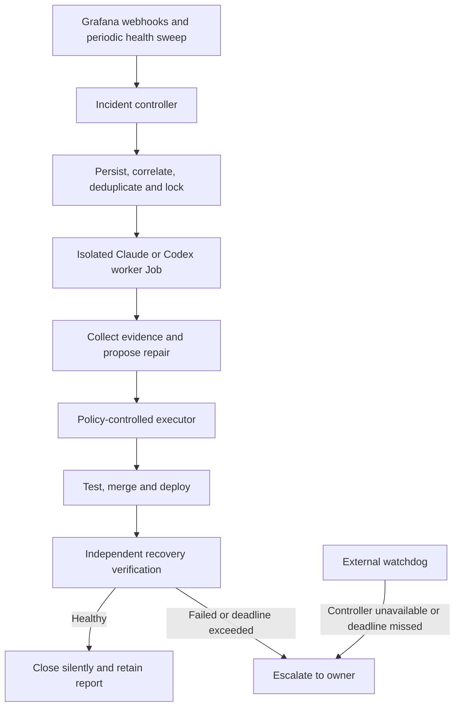

# Automated cluster repair agent plan

Status: planned; no agent, permissions, or notification changes deployed.
Agreed direction: **bounded repairs with automatic tested merges and deployments**.
Written 2026-10-20.

## Objective

Catch cluster incidents, investigate and repair them within an explicit policy,
verify sustained recovery, and notify the owner only when automatic recovery
cannot complete. Successful repairs remain auditable without push notifications.
This document defines the design; it does not authorize implementation by itself.

## Architecture

The controller owns durable incident state, deadlines, locks, retries, budgets,
and notification decisions. The model investigates and proposes actions. A
separate executor validates and performs mutations. The verifier checks outcomes
against explicit probes and acceptance criteria, not the worker's conclusion.

Deploy the controller independently of the interactive Claude workspace. Each
incident worker receives its own Kubernetes Job and isolated checkout. Start
with one production repair at a time. Persist state and evidence outside worker
pods so a restart does not lose an incident or repeat a completed action.
Select the durable database and its backup/recovery arrangement before rollout.

Claude and Codex adapters should expose the same structured result: diagnosis,
supporting evidence, proposed actions, expected impact, verification steps,
rollback plan, and outcome. Codex's documented noninteractive mode supports
JSON events and schema-constrained results; pin and validate the chosen runtime
before implementation. Select and validate the Claude interface separately.

## Incident lifecycle

1. Authenticate and validate an incoming alert; persist it before acknowledging
   receipt. Periodically reconcile firing alerts to catch missed webhooks.
2. Deduplicate by alert identity and incident generation. Correlate dependent
   symptoms into a root incident, such as a node outage affecting many services.
3. Acquire workload and repository locks. Respect maintenance exclusions and
   work claimed by a person or another agent, such as an ongoing Smite repair.
4. Collect bounded, redacted evidence: recent changes, Kubernetes events,
   application probes, logs, metrics, repository configuration, and runbooks.
5. Diagnose and choose an action covered by the approved repair policy.
6. Execute the repair, recording its preconditions, exact revision, result, and
   rollback information. Recheck preconditions immediately before mutation.
7. Verify fresh telemetry, direct application behavior, the original symptom,
   and a stability window. A successful command alone is not recovery.
8. Close silently, wait for a known external dependency, or escalate with the
   specific action needed from the owner.

Suggested states: `received`, `investigating`, `repairing`, `verifying`,
`waiting_external`, `resolved`, and `escalated`. Waiting releases the worker;
scheduled checks resume the incident without continuous model calls. Waiting
must have a deadline and must not suppress escalation indefinitely.

Actions need idempotency keys and an execution journal. After a controller crash,
inspect whether an action took effect before retrying it. Use expiring leases
with fencing so a stale worker cannot continue after another worker takes over.
Resolved and firing events may arrive out of order; retain incident generations
and recheck live conditions before acting.

## Automatic repair boundaries

| Area | Allowed within an approved runbook | Escalate |
|---|---|---|
| Stateless services | Targeted replica restart; rollback to a known-good revision | Unsuccessful recovery or effects outside the target |
| Jobs | One retry of explicitly retry-safe work; clean terminal diagnostic jobs after retaining evidence | Possible duplicate data changes; active investigations |
| Application configuration | Tested changes in approved paths with bounded parameters | Disabling functionality; unfamiliar migrations |
| Resources | Adjust approved workload limits within explicit bounds and available node capacity | Unbounded increases, storage exhaustion requiring deletion, database repair |
| Repositories | Branch, PR, tests, automatic merge and deployment in approved repositories | Policy violations or missing required checks |
| Dependencies | Fixes within approved version ranges and upgrade procedures | Major upgrades without an established procedure |
| External services | Backoff and recheck until the incident deadline | Local action cannot restore service |

Excluded from automatic scope: node reboot/drain, SSH and privileged host
changes, database restores, destructive migrations, data deletion, PVC
deletion/shrinkage, and changes to the agent's own deployment, permissions,
policies, or watchdog. Changes that weaken tests, alerts, CI, or branch protection
are also excluded. These are escalation boundaries, not interactive permission
prompts inside a running unattended worker.

## Git, CI, merge and deployment

For a persistent repair:

1. Create an incident branch and PR from a known base revision.
2. Run policy checks, required CI, and relevant application tests against the
   exact proposed revision. Inspect changed paths and dependency changes.
3. Have the controller independently verify the results. The worker cannot
   declare its own checks passed or grant itself merge authority.
4. Merge only if the tested revision and base still match the accepted merge
   strategy. A changed base or merge result requires renewed validation.
5. Deploy the resulting tested revision and immutable image digest; record the
   previous deployed revision and applicable rollback procedure.
6. Verify recovery, then reconcile the incident's source and live state.

Use a narrowly scoped GitHub App for controller merge/deployment authority.
Workers receive branch-scoped capabilities where possible, not the controller's
merge credentials. Changes to CI workflows and executable deployment scripts
require escalation because they can bypass the checks.

Approved urgent restarts and rollbacks can precede a PR. Any persistent live
patch must be represented in Git before the incident closes. Rollback is only
automatic when the runbook establishes compatibility; reverting an image does
not undo a database migration.

## Verification and limits

Proposed starting defaults, to encode in policy before enabling repairs:

- One production repair at a time, with workload and repository locks.
- Two repair attempts per incident; at most one retry-safe job retry.
- One automatic rollback, followed by verification and escalation if unhealthy.
- Fifteen-minute ordinary incident deadline, including verification; shorter
  critical deadlines and longer known waits must be explicitly defined per rule.
- Ten minutes of sustained application health before ordinary incidents close.
- Explicit per-incident and daily model-spend limits, worker resource limits,
  bounded tool output, and execution timeouts. Numerical spend limits remain to
  be chosen before activation.
- Repeated recurrence reopens/correlates the incident and eventually escalates;
  it must not trigger an unlimited restart loop.

Missing metrics are unknown, not healthy. Require fresh timestamps, direct
application probes, and the original alert condition clearing. Check affected
dependencies for regressions. Observe the rollback with the same rigor as the
repair. Record incomplete evidence and escalate when verification is impossible.

The October 2026 Grafana ingestion incident is a useful example: successful
local scrapes plus Cloud rejection should lead to bounded provider-recovery
checks after reducing series volume, rather than repeated Prowlarr restarts.

## Notifications and independent failure detection

Use the existing [notification routing](notification-routing.md): ntfy first,
SMS on publish failure, and Grafana Cloud email only when ntfy is explicitly
unavailable. This reflects the stricter email policy agreed on 2026-10-20;
critical severity or missing telemetry alone must not trigger email.
SMS availability must be verified before treating it as a working fallback.

Successful repairs write an incident report without paging. Escalations contain
impact, diagnosis and evidence, actions attempted, PR/deployment references,
current state, and the exact owner decision or physical action required.
Deduplicate updates by incident; send meaningful changes and bounded reminders,
not a new notification for each tool error or repeated alert delivery.

During agent-managed incidents, replace direct application paging with bounded
deadline-based escalation, or the owner will receive duplicate alerts. Make this
a staged routing change: retain existing paging until takeover, persistence,
deadline handling, and recovery have been demonstrated.

An external watchdog must independently observe controller heartbeat and
incident deadlines. A controller heartbeat alone is insufficient: the controller
may be alive while workers are stuck. The external path needs enough incident
state to escalate if an alert was acknowledged and the controller then failed.
Select the external deadline-store/watchdog implementation before activation;
an in-cluster timer alone cannot provide this guarantee.

Controller, cluster, model-provider, authentication, or notification-path failure
means automatic repair is unavailable and warrants escalation through the
external path. Do not route watchdog notifications through the failed agent.
Keep the conditional email route and watchdog configuration outside worker
authority. Before activation, define how the external watchdog proves ntfy
unavailability independently while respecting that email condition. A complete cluster outage cannot be reported reliably by an agent
inside that cluster.

## Credentials, isolation and audit

Enforce action boundaries with Kubernetes RBAC and executor-side validation,
not prompts alone. Workers should have restricted egress and no default host
mounts, privileged pods, cluster-admin token, or broad secret access. Exclude
permission-changing API operations from the action interface.

Treat logs, alert annotations, external responses, and repository content as
untrusted evidence rather than executable instructions. Redact sensitive data
before model calls. Keep model credentials separate from repository build/test
environments; use dedicated automation credentials rather than the interactive
workspace's login state.

Retain incident timelines, evidence references, action journals, commit/image
identities, CI results, verification samples, rollback results, and cost. Define
retention and redaction limits before rollout. Provide an owner-controlled pause
switch and per-workload exclusions; preserve escalation while repairs are paused.

## Rollout and acceptance

1. **Observe:** receive alerts without changing paging or workloads. Replay past
   incidents and compare diagnoses/actions with actual repairs.
2. **Bounded repairs:** enable a small allowlist of proven runbooks. Exercise
   rollback, persistence, deadline escalation, and independent failure detection.
3. **Automatic tested delivery:** enable approved repositories, required checks,
   merge rules, deployment commands, probes, and rollback procedures.
4. **Quiet operation:** transfer eligible paging to the controller only after
   proving incidents cannot disappear when components fail. Expand the allowlist
   based on observed results.

Acceptance exercises must cover duplicate/out-of-order alerts, controller
restarts mid-action, stale locks, simultaneous human changes, failing CI, changed
merge bases, failed rollbacks, stale/missing telemetry, model unavailability,
budget exhaustion, prompt injection in logs, a broken notification relay, and a
fully unreachable cluster. Each must either recover within policy or produce an
independent, actionable escalation.

## Implementation decisions still required

- Initial workload/repository/path allowlists and maintenance ownership.
- Per-runbook bounds, required tests, probes, deadlines, and rollback commands.
- Controller/database implementation and external watchdog/deadline storage.
- Model adapter, authentication, model selection, and numerical spend budgets.
- GitHub App permissions, merge strategy, deployment identity, and image provenance.
- Audit retention, incident-history interface, and pause/exclusion controls.

Suggested source locations are `infra/cluster-agent/` for the controller chart,
executor and policy, and `docs/runbooks/` for reviewed recovery procedures.
These paths are proposed; no implementation is created by this plan.

## References

- [Codex noninteractive execution and structured results](https://learn.chatgpt.com/docs/non-interactive-mode)
- [Notification routing](notification-routing.md)
- [Application health coverage](../infra/health-exporter/README.md)
- [Grafana alert rules](../infra/grafana-dashboards/alerts/rules.json)
- [Alloy ingestion limits and recovery](../infra/alloy/README.md)
